```{python}
#| include: false
# Every number quoted on the slides is read from the saved results here, so
# the text cannot disagree with the figures. README.md says how to make them.
import sys
from pathlib import Path

REPOSITORY = Path.cwd().resolve().parents[1]
sys.path.insert(0, str(REPOSITORY))

from experiments.presentation_aimes_talk import config, results

toy = results.load(results.ToyResults, config.TOY_RESULTS_FILE)
north_america = results.load(results.NorthAmericaPrior, config.NORTH_AMERICA_FILE)

n_pool_sites = f"{len(north_america.site_ids):,}"
n_tower_sites = len(north_america.tower_site_ids)
n_toy_sites = len(toy.training_locations)
n_toy_towers = int(toy.is_tower.sum())
mcmc_runs = f"{toy.reference_model_runs_per_site:,}"
ipl_runs = int(toy.ipl_history.runs_per_site[-1])
fewer_runs = f"{toy.reference_model_runs_per_site / ipl_runs:,.0f}"
ipl_ensemble_size = config.IPL_ENSEMBLE_SIZE
ipl_iterations = len(toy.ipl_history.runs_per_site)

TURNOVER = 1
site_by_site_error = toy.site_by_site.held_out_root_mean_square_error[TURNOVER]
spatial_error = toy.spatial_reference.held_out_root_mean_square_error[TURNOVER]
error_reduction = f"{100 * (1 - spatial_error / site_by_site_error):.0f}%"
```

## Calibration today: one site at a time

:::: {.columns}
::: {.column width="58%"}
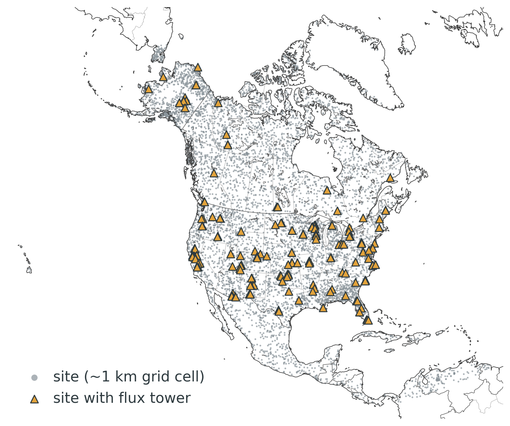{width=100%}
:::
::: {.column width="42%" .smaller-list}
- `{python} n_pool_sites` sites across North America
- Rich data (eddy covariance) at only `{python} n_tower_sites`
- Everywhere else: sparse remote sensing and inventories
- Standard practice: calibrate **each site** (or each plant functional type) **on its own**

::: {.fragment .box}
But parameters vary smoothly with climate and place: a site's neighbors know something about it.
:::
:::
::::

::: notes
The pool: 8000 sites chosen for coverage of North America's ecoregions. Towers are where we have rich, high-frequency data. Most sites see only sparse remote sensing. The community calibrates pixel by pixel or by PFT. Our idea is to treat the parameters as a map.
:::

## The idea: parameters are maps

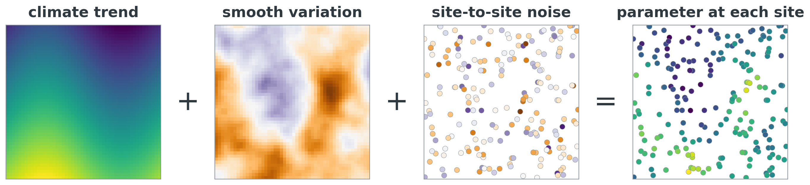{height=210px fig-align="center"}

::: {.fragment}
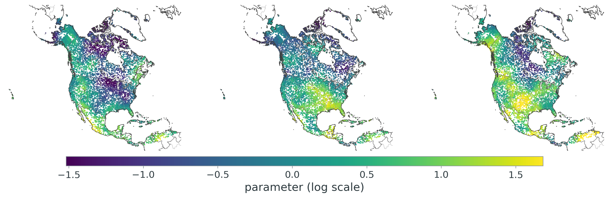{height=240px fig-align="center"}

[Three possible parameter maps, drawn from a spatial prior over the `{python} n_pool_sites` sites]{.caption}
:::

::: notes
Each parameter is a field: a climate trend, plus smooth spatial variation the covariates miss, plus site-to-site noise. That's the prior, before any data. Bottom: three draws from such a prior over the real site pool. Calibrating means learning this map, not 8000 separate numbers.
:::

## How data at one site informs its neighbors

::: {.r-stack}
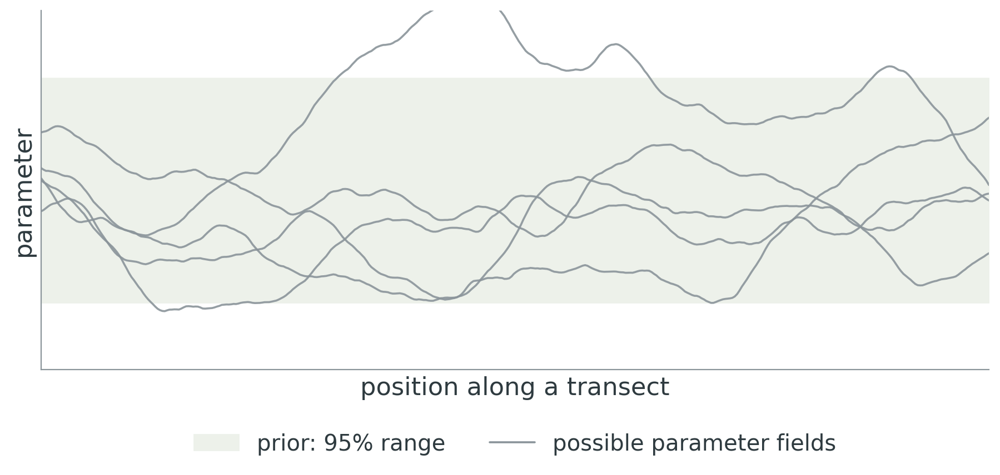{.fragment .fade-out fragment-index=1 height=400px}

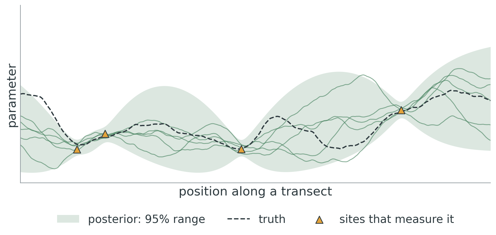{.fragment fragment-index=1 height=400px}
:::

::: {.fragment .box .center-text fragment-index=2}
Close to a measured site the parameter is pinned down; far away, we honestly don't know.
:::

::: notes
A one-dimensional picture. Before data, any of these curves is plausible. After a few sites measure the parameter, the posterior is tight near those sites and widens away from them. How far information travels is set by the spatial correlation length, which is itself learned from data in the full method.
:::

## A toy world to test the idea

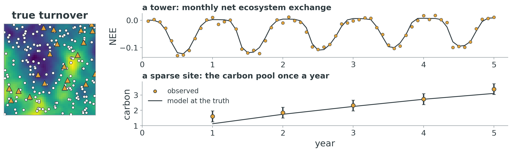{width=100%}

- `{python} n_toy_sites` sites, `{python} n_toy_towers` with a "tower"; a one-pool carbon model stands in for SIPNET
- Two parameters, **productivity** and **turnover**, each a spatial field; we know the truth

::: notes
A synthetic world where we know the answer. The model has GPP and temperature-dependent respiration of one carbon pool. Towers see monthly NEE; every other site sees only its carbon pool once a year, like an inventory.
:::

## Alone, a sparse site suffers from equifinality

:::: {.columns}
::: {.column width="52%"}
::: {.r-stack}
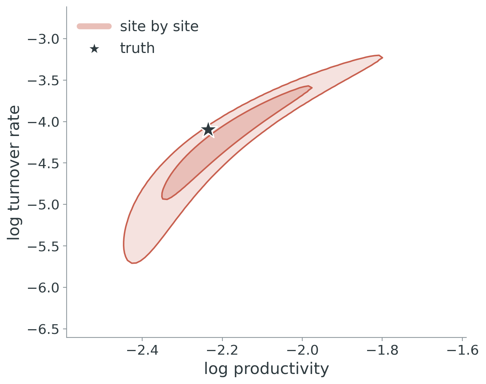{.fragment .fade-out fragment-index=1 width=100%}

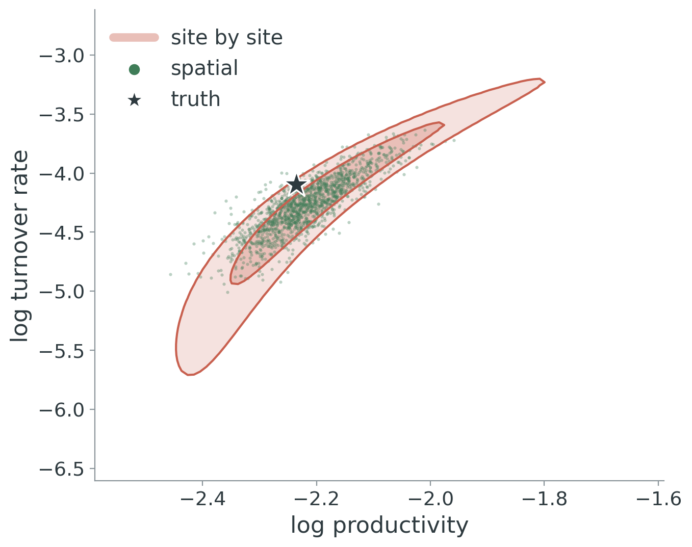{.fragment fragment-index=1 width=100%}
:::
:::
::: {.column width="48%"}
- From annual pools alone, high productivity with fast turnover looks like low productivity with slow turnover
- Calibrated **site by site**, the answer is a long ridge

::: {.fragment fragment-index=1}
- Calibrated **spatially**, nearby sites (and the tower) cut the ridge down
:::
:::
::::

::: notes
This is one sparse site. In red, its posterior on its own: a curved ridge, the classic equifinality. In green, the same site under the spatial model: neighbors that do see NEE resolve the ambiguity, and the truth (star) is inside.
:::

## The result: a map, not a scatter of guesses

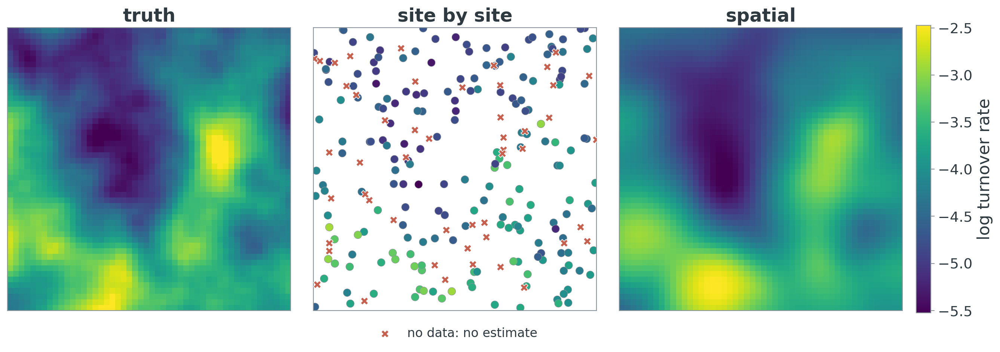{width=100%}

::: {.fragment .box .center-text}
At sites with **no data**, the spatial model's error in turnover is `{python} error_reduction` lower than the site-by-site answer (which there is just the prior).
:::

::: notes
Turnover, the harder parameter. Left, the truth. Middle, site by site: noisy, and nothing at sites without data (crosses). Right, the spatial posterior mean: the map's structure is recovered, including at sites never observed.
:::

## Scaling it up: no gradients, few model runs

:::: {.columns}
::: {.column width="45%"}
::: {.pipeline}
::: {.step}
**1. Run locally.** A small ensemble (`{python} ipl_ensemble_size` runs) of the model at every site, all in parallel
:::
::: {.step}
**2. Summarize locally.** Fit how each site's outputs respond to its parameters
:::
::: {.step}
**3. Combine globally.** One fast spatial update shares information across sites
:::
:::
[Repeat until it settles (here `{python} ipl_iterations` times): iterated posterior linearization]{.caption}
:::
::: {.column width="55%"}
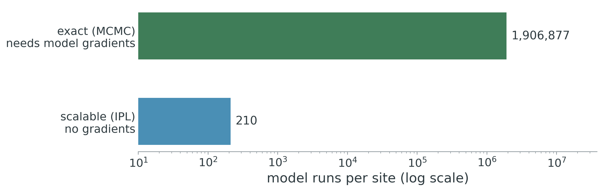{width=100%}

::: {.fragment}
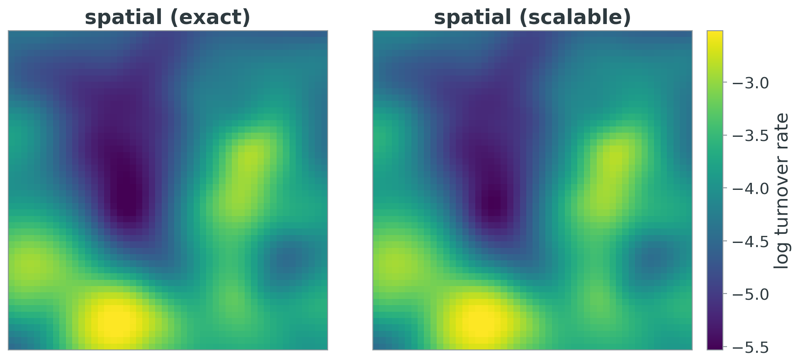{width=100%}
:::
:::
::::

::: notes
The exact spatial posterior needs MCMC with gradients of the model, which SIPNET doesn't have, and millions of runs per site. Our approach only ever runs the model in small local ensembles that are embarrassingly parallel, and does the spatial part with cheap Gaussian algebra. Here it needs about four orders of magnitude fewer runs and gives essentially the same map.
:::

## Where this goes next

- **Spatial calibration** borrows strength across sites: fewer equifinality problems, and predictions where there are no data
- **Scalable**: model runs stay local and parallel; only cheap algebra is global
- **Next**: SIPNET at thousands of North American sites, with MODIS LAI, biomass, soil carbon and AmeriFlux NEE
- **Then**: use the posterior map to decide **where new observations would help most**

::: {.box .center-text}
[contact / acknowledgments placeholder]
:::

# Backup {.unnumbered .unlisted}

## Uncertainty: where we know, and where we don't

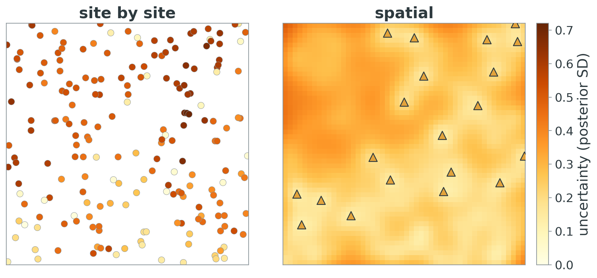{width=80%}

## Error at sites with no data

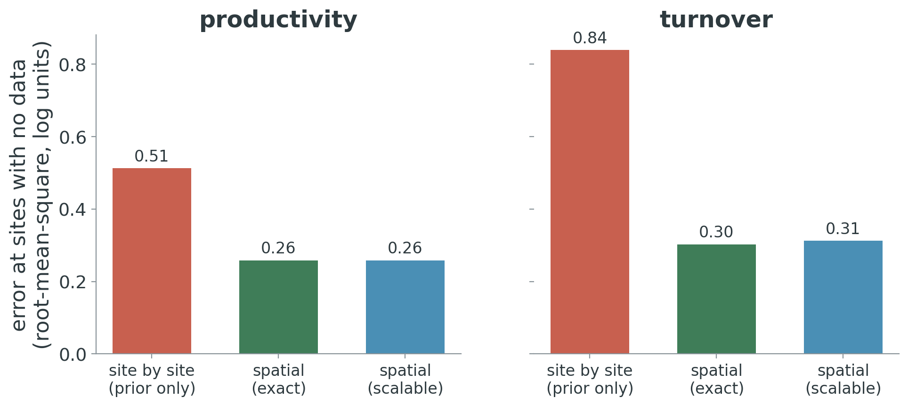{width=80%}

## The scalable method converges in a few iterations

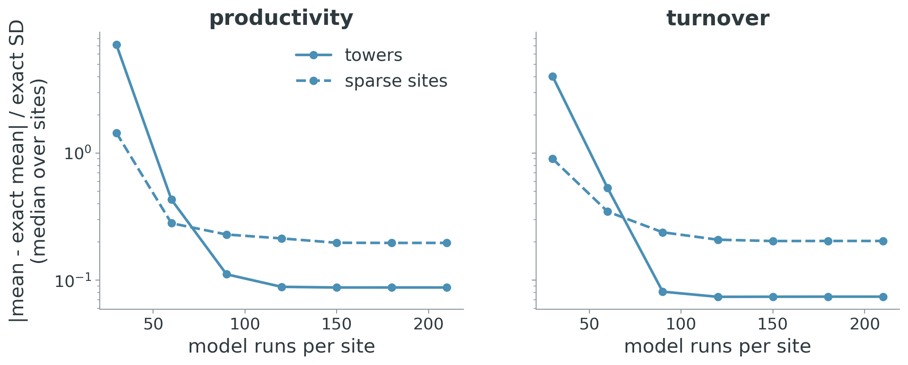{width=90%}

## The toy problem in full

- Region: unit square; `{python} n_toy_sites` training and `{python} len(toy.held_out_locations)` held-out sites, uniform at random
- Model: monthly, one pool; GPP $= a\,L_t\,\sigma\!\big((T_t-5)/3\big)$; respiration $= C_t\,(1-e^{-k_t})$, $k_t = k\,e^{0.09 (T_t-10)}$; 5 years
- Prior on $\theta = (\log a, \log k)$: climate trend + Matérn-3/2 Gaussian process + site noise; all hyperparameters known
- Data: annual pool at every site (10% noise); monthly NEE at towers (15% noise)
- Methods: site by site (exact, on a grid); spatial reference (NUTS, `{python} mcmc_runs` runs with gradients per site); IPL (`{python} ipl_runs` runs per site, no gradients)
