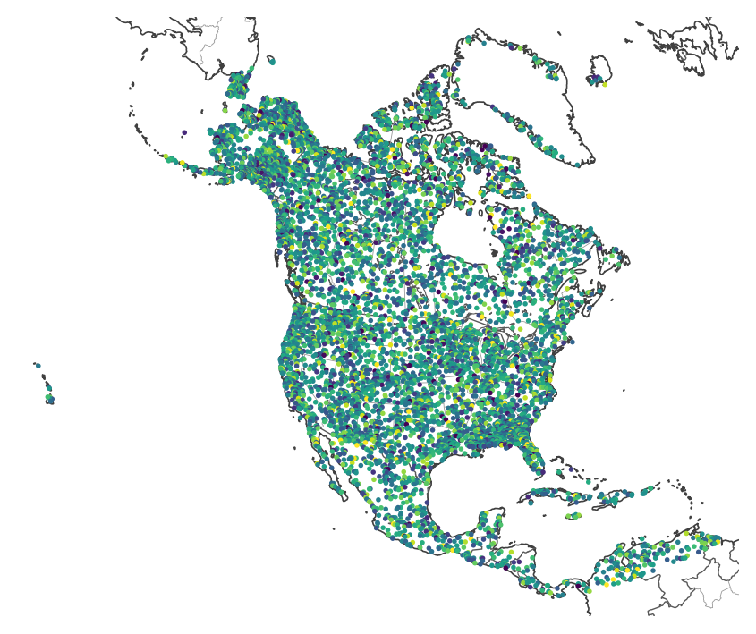
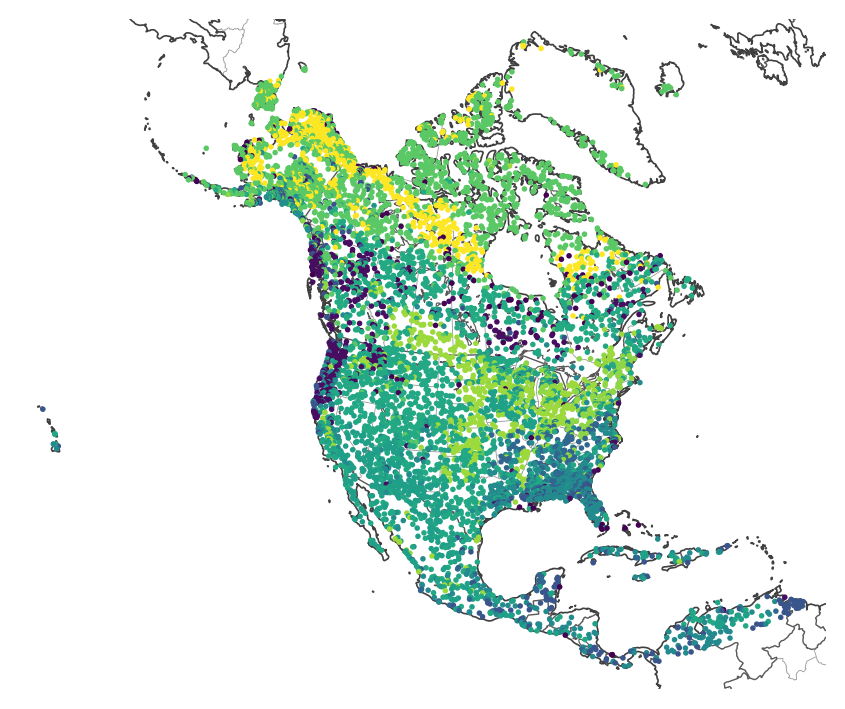
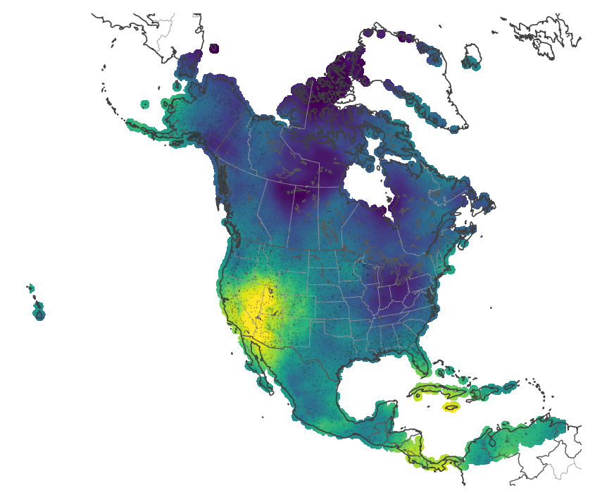
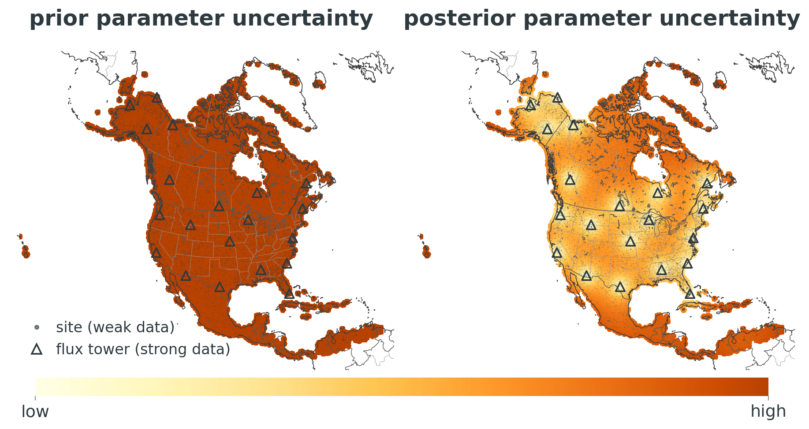

```{python}
#| include: false
# Every number quoted on the slides is read from the saved results here, so
# the text cannot disagree with the figures. README.md says how to make them.
import sys
from pathlib import Path

REPOSITORY = Path.cwd().resolve().parents[1]
sys.path.insert(0, str(REPOSITORY))

from experiments.presentation_aimes_talk import config, results

toy = results.load(results.ToyResults, config.TOY_RESULTS_FILE)

n_toy_sites = len(toy.training_locations)
n_toy_towers = int(toy.is_tower.sum())
mcmc_runs = f"{toy.reference_model_runs_per_site:,}"
ipl_runs = int(toy.ipl_history.runs_per_site[-1])
ipl_ensemble_size = config.IPL_ENSEMBLE_SIZE
ipl_iterations = len(toy.ipl_history.runs_per_site)

TURNOVER = 1
site_by_site_error = toy.site_by_site.held_out_root_mean_square_error[TURNOVER]
spatial_error = toy.spatial_reference.held_out_root_mean_square_error[TURNOVER]
error_reduction = f"{100 * (1 - spatial_error / site_by_site_error):.0f}%"
```

## Spatial structure

:::: {.columns .centered-columns}
::: {.column width="62%"}
{height=560px}
:::
::: {.column width="38%" .options-list}
::: {.fragment}
- learn independently by site?
:::

::: {.fragment}
- treat all sites the same (within a PFT)?
:::

::: {.fragment}
- incorporate spatial structure [(this talk)]{.forest}
:::
:::
::::

::: notes
The pool: 8000 sites, each a roughly 1 km grid cell, chosen for coverage of North America's ecoregions. The triangles are sites with a flux tower: rich, high-frequency data. Everywhere else we have only sparse remote sensing and inventories.

How should we calibrate across these sites? Site by site, with no sharing; or one parameter set for every site of a PFT, ignoring variation within it. We do something in between: let the parameters vary in space, and learn how much.
:::

## A first step: spatial parameter calibration

:::: {.columns .options-grid}
::: {.column width="33%"}
::: {.fragment}
[Independent]{.option-name}

$y_s = \mathcal{G}_s(\theta_s) + \epsilon_s$

{width=100%}

[a separate $\theta_s$ at every site; nothing shared]{.caption}
:::
:::
::: {.column width="33%"}
::: {.fragment}
[By PFT]{.option-name}

$y_s = \mathcal{G}_s(\theta_{\mathrm{pft}(s)}) + \epsilon_s$

{width=100%}

[one $\theta$ per PFT; no variation within a PFT]{.caption}
:::
:::
::: {.column width="33%"}
::: {.fragment}
[Spatial]{.option-name .forest}

$y_s = \mathcal{G}_s(\theta(x_s)) + \epsilon_s$

{width=100%}

[a field $\theta(x)$, defined everywhere]{.caption}
:::
:::
::::

::: notes
The same three options, three ways: in words, as the model, and as a map of one parameter. Here y_s is site s's data, G_s the model run at site s, and epsilon_s the error. Independent: every site has its own parameter, and nothing is shared, which is salt-and-pepper on the map. By PFT: every site of a PFT shares one value, so the map is patches that follow vegetation type, with no variation within a PFT. Spatial: the parameter is a field theta(x), defined everywhere, not just at the sites; a site reads it at its location x_s, and nearby sites inform each other.
:::

## Spatial parameter model

{width=100%}

::: {.fragment .prior-model}
prior model: $\theta(x) = \underbrace{z(x)^\top \beta}_{\text{spatial covariates}} + \underbrace{u(x)}_{\text{Gaussian process}}$
:::

::: notes
Three draws from a spatial prior over one parameter at the real sites: each is a possible map of the parameter before we see any data. The prior model: a trend in spatial covariates such as mean annual temperature, plus a Gaussian process for the smooth variation the covariates miss. Calibrating means learning this map, not 8000 separate numbers.
:::

## Borrowing strength across space

{height=470px fig-align="center"}

::: {.fragment .box .center-text .compact-box}
Uncertainty drops everywhere, and most around the flux towers.
:::

::: notes
Left: before any data, the parameter is equally uncertain everywhere. Right: after conditioning on the data. Every site has weak data, think remote sensing, and a handful of flux towers have strong data. Uncertainty drops everywhere, because each site's weak data are pooled with its neighbors', and it drops most around the towers, whose information spreads to the sites near them. This is what a site-by-site calibration cannot do: a site with weak data would stay uncertain however close it is to a tower.
:::

## A toy model

{.nostretch width=100%}

::: {.compact-list}
- Toy single-pool carbon model
- Two parameters: **productivity** and **turnover**
- `{python} n_toy_sites` sites, `{python} n_toy_towers` with a "tower"
- Try to recover true parameters (each a spatial field)
:::

::: notes
A synthetic world where we know the answer. The model has GPP and temperature-dependent respiration of one carbon pool. Towers see monthly NEE; every other site sees only its carbon pool once a year, like an inventory.
:::

## Alone, a sparse site suffers from equifinality

:::: {.columns}
::: {.column width="52%"}
::: {.r-stack}
{.fragment .fade-out fragment-index=1 width=100%}

{.fragment fragment-index=1 width=100%}
:::
:::
::: {.column width="48%"}
- From annual pools alone, high productivity with fast turnover looks like low productivity with slow turnover
- Calibrated **site by site**, the answer is a long ridge

::: {.fragment fragment-index=1}
- Calibrated **spatially**, nearby sites (and the tower) cut the ridge down
:::
:::
::::

::: notes
This is one sparse site. In red, its posterior on its own: a curved ridge, the classic equifinality. In green, the same site under the spatial model: neighbors that do see NEE resolve the ambiguity, and the truth (star) is inside.
:::

## The result: a map, not a scatter of guesses

{width=100%}

::: {.fragment .box .center-text}
At sites with **no data**, the spatial model's error in turnover is `{python} error_reduction` lower than the site-by-site answer (which there is just the prior).
:::

::: notes
Turnover, the harder parameter. Left, the truth. Middle, site by site: noisy, and nothing at sites without data (crosses). Right, the spatial posterior mean: the map's structure is recovered, including at sites never observed.
:::

## Scaling it up: no gradients, few model runs

:::: {.columns}
::: {.column width="45%"}
::: {.pipeline}
::: {.step}
**1. Run locally.** A small ensemble (`{python} ipl_ensemble_size` runs) of the model at every site, all in parallel
:::
::: {.step}
**2. Summarize locally.** Fit how each site's outputs respond to its parameters
:::
::: {.step}
**3. Combine globally.** One fast spatial update shares information across sites
:::
:::
[Repeat until it settles (here `{python} ipl_iterations` times): iterated posterior linearization]{.caption}
:::
::: {.column width="55%"}
{width=100%}

::: {.fragment}
{width=100%}
:::
:::
::::

::: notes
The exact spatial posterior needs MCMC with gradients of the model, which SIPNET doesn't have, and millions of runs per site. Our approach only ever runs the model in small local ensembles that are embarrassingly parallel, and does the spatial part with cheap Gaussian algebra. Here it needs about four orders of magnitude fewer runs and gives essentially the same map.
:::

## Where this goes next

- **Spatial calibration** borrows strength across sites: fewer equifinality problems, and predictions where there are no data
- **Scalable**: model runs stay local and parallel; only cheap algebra is global
- **Next**: SIPNET at thousands of North American sites, with MODIS LAI, biomass, soil carbon and AmeriFlux NEE
- **Then**: use the posterior map to decide **where new observations would help most**

::: {.box .center-text}
[contact / acknowledgments placeholder]
:::

# Backup {.unnumbered .unlisted}

## Uncertainty: where we know, and where we don't

{width=80%}

## Error at sites with no data

{width=80%}

## The scalable method converges in a few iterations

{width=90%}

## Toy land surface model {.math-slide}

One carbon pool $C_t$ at each site, run monthly for `{python} config.N_MONTHS // 12` years:

$$
\begin{aligned}
C_{t+1} &= C_t + \mathrm{GPP}_t - R_t, && C_0 = c_0 \\[2pt]
\mathrm{GPP}_t &= a\, L_t\, \sigma\!\left(\frac{T_t - T_{1/2}}{w}\right) && \text{photosynthesis} \\[2pt]
R_t &= C_t \left(1 - e^{-k_t}\right), \quad k_t = k\, e^{\gamma\,(T_t - T_{\mathrm{ref}})} && \text{respiration} \\[2pt]
\mathrm{NEE}_t &= R_t - \mathrm{GPP}_t && \text{net ecosystem exchange}
\end{aligned}
$$

- Drivers: monthly temperature $T_t$ (the site's climate, a seasonal cycle and weather) and light $L_t$ (a seasonal cycle); $\sigma$ is the logistic function
- Outputs $\mathcal{G}_s$: monthly NEE, and the pool at the end of each year
- **Calibrated**: $a$, **productivity**, carbon uptake per unit light when it is warm; $k$, **turnover rate**, the fraction of the pool respired per month at $T_{\mathrm{ref}}$ ($1/k$ is the carbon's residence time)
- Fixed: $T_{1/2} = `{python} config.TEMPERATURE_HALF_SATURATION`$ °C, $w = `{python} config.TEMPERATURE_SATURATION_WIDTH`$ °C, $\gamma = `{python} config.RESPIRATION_TEMPERATURE_SENSITIVITY`$ /°C, $T_{\mathrm{ref}} = `{python} config.REFERENCE_TEMPERATURE`$ °C, $c_0 = `{python} config.INITIAL_POOL`$

## Toy calibration model {.math-slide}

`{python} n_toy_sites` sites $s$ at locations $x_s$ in a square region, `{python} n_toy_towers` of them towers:

$$
\begin{aligned}
y_s &= \mathcal{G}_s\big(\theta(x_s)\big) + \epsilon_s, \qquad \epsilon_s \sim \mathcal{N}(0, \Sigma_s) && \text{data} \\[2pt]
\theta(x) &= \big(\log a(x),\ \log k(x)\big) && \text{parameters} \\[2pt]
\theta_p(x) &= \beta_{p0} + \beta_{p1}\, z(x) + \sigma_p\, u_p(x) + \tau_p\, \eta_p(x) && \text{prior, } p = 1, 2 \\[2pt]
u_p &\sim \mathcal{GP}\big(0,\ c_{\ell_p}\big), \quad \eta_p(x) \overset{\text{iid}}{\sim} \mathcal{N}(0, 1) \\[2pt]
\pi(\theta_X \mid y) &\propto \textstyle\prod_s p\big(y_s \mid \theta(x_s)\big)\ \pi(\theta_X) && \text{posterior}
\end{aligned}
$$

- $y_s$: the pool at the end of each year at every site (`{python} f"{config.POOL_RELATIVE_NOISE:.0%}"` noise), and monthly NEE at towers (`{python} f"{config.NEE_RELATIVE_NOISE:.0%}"` noise); $\Sigma_s$ diagonal and known
- $z(x)$: a climate covariate (mean annual temperature); $u_p$: smooth spatial variation, with $c_\ell$ the Matérn-3/2 covariance of length scale $\ell$; $\eta_p$: site-to-site noise; the two parameters independent a priori
- $\theta_X = \big(\theta(x_1), \ldots, \theta(x_S)\big)$: every site's parameters, jointly. Known, not learned: $\beta$, $\sigma_p$, $\ell_p$, $\tau_p$

## Inference algorithms

- **Site by site**: each site alone, with its own prior (its marginal under the spatial prior); the exact posterior, computed on a grid
- **Spatial, exact**: NUTS (gradient-based MCMC) on every site's parameters jointly; `{python} mcmc_runs` model runs per site, with gradients. The reference
- **Spatial, scalable**: iterated posterior linearization. Each iteration runs a small ensemble (`{python} ipl_ensemble_size` runs) at every site, fits each site's outputs linearly in its parameters, and makes one Gaussian update over all sites; `{python} ipl_runs` model runs per site in all (`{python} ipl_iterations` iterations), no gradients
